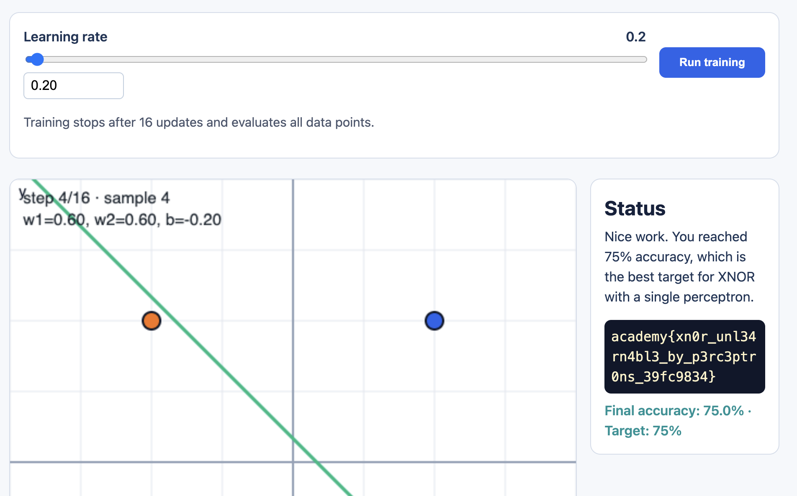

# Perceptron Train XNOR

## Metadata

- Platform: CyLab Academy
- Learning Path: AI Foundations I - The Lost Book of Perceptrons
- Challenge: [Perceptron Train XNOR](https://learn.cylabacademy.org/learning-paths/20/223)
- Category: Artificial Intelligence
- Difficulty: Easy
- Status: Solved
- Started: 2026-10-13
- Completed: 2026-10-13
- Re-solve: 2026-10-20
- Files: none (browser-only service)
- Skills Learned: XNOR and linear separability

## Problem Summary

The service trains one perceptron on four XNOR points. XNOR outputs `1` when
the inputs match and `0` when they differ. The service accepts `75%` accuracy
because one straight line cannot separate all four labels.

| y | x = -2 | x = 2 |
| --- | ---: | ---: |
| 2 | 0 | 1 |
| -2 | 1 | 0 |

## Prediction

- Guess: not recorded before the runs
- Score: n/a

## Solve Log

I tried learning rates `0.02` and `0.20`. Both runs reached `75%` and showed
the flag. They ended with different weights, but both got three of the four
points right.

| Learning rate | w1 | w2 | b | Accuracy |
| ---: | ---: | ---: | ---: | ---: |
| `0.02` | 0.96 | 0.96 | -0.02 | 75% |
| `0.20` | 0.60 | 0.60 | -0.20 | 75% |

This screenshot is from the `0.20` run:



## What the Final Weights Did

For the `0.20` run, the score was `0.60x + 0.60y - 0.20`. The perceptron
predicts `1` for a positive score and `0` for a negative score.

| Input | Expected | Score | Prediction |
| --- | ---: | ---: | ---: |
| `(-2, -2)` | 1 | -2.60 | 0 |
| `(-2, 2)` | 0 | -0.20 | 0 |
| `(2, -2)` | 0 | -0.20 | 0 |
| `(2, 2)` | 1 | 2.20 | 1 |

Only `(-2, -2)` is wrong, so the result is `3 / 4 = 75%`. The `0.02` run
ended with different weights, but its line made the same three predictions
correctly.

## Why 100% Is Impossible

The two `1` points sit on one diagonal. The two `0` points sit on the other.
The line segment between each pair crosses at the square's center. A single
straight boundary cannot put both pairs on opposite sides, so one perceptron
cannot classify all four points correctly. Changing the learning rate changes
the updates; it does not change this limit.

## Solution Walkthrough

1. Open the challenge service.
2. Run training with learning rate `0.02`, then `0.20`.
3. Confirm both runs reach the `75%` target.
4. Submit the flag:

```text
academy{xn0r_unl34rn4bl3_by_p3rc3ptr0ns_39fc9834}
```

CyLab accepted the flag and marked the challenge solved.

## Commands Or Script

None. The runs happened in the browser.

## Lessons Learned

- XNOR has the same diagonal-label problem as XOR. Flipping the labels does
  not make the four points linearly separable.
- A single perceptron can get three of these four points right, but not all
  four.
- Different learning rates can produce different weights and the same
  accuracy.

## Follow-Up

- Cold re-solve due 2026-10-20.
- Next: Perceptron Train Hole in Middle.
